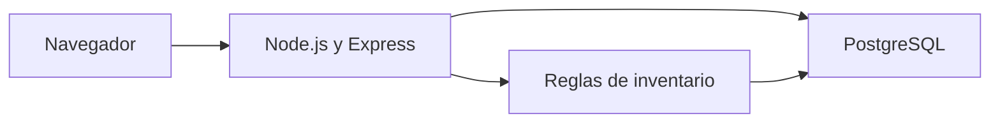
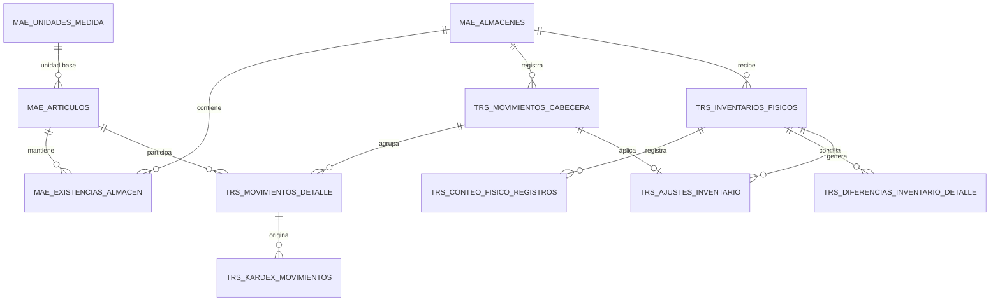

# Arquitectura y correcciones de la base

## Implementación

La interfaz web usa HTML, CSS y JavaScript. Express recibe sus solicitudes del mismo origen, valida la sesión y ejecuta las operaciones de inventario. PostgreSQL 18 almacena el esquema `inventario` con las tablas del respaldo entregado por el equipo. El acceso a datos utiliza consultas parametrizadas y transacciones de PostgreSQL. El entorno de demostración usa la moneda PEN, un usuario local y datos simulados.

## Modelo relacional principal

El kardex admite registros históricos anulados y exige un máximo de una fila **activa** por línea de movimiento. Las tablas de cabecera y detalle distinguen los importes del documento de los costos de salida. Inventario físico separa el conteo, la diferencia y el ajuste que impacta el kardex.

| Tabla | Uso |
|---|---|
| `mae_articulos`, `mae_unidades_medida`, `mae_articulo_unidades`, `mae_almacenes` | Identifican productos, unidades base y alternativas, factores de conversión y almacenes. |
| `mae_existencias_almacen` | Conserva unidades, promedio y saldo valorizado por combinación de almacén y artículo. |
| `trs_movimientos_cabecera`, `trs_movimientos_detalle` | Guardan documento interno, tipo de operación, almacén, artículo, cantidades y precio o costo documentario. |
| `trs_kardex_movimientos` | Guarda el costo aplicado, las entradas o salidas y el saldo posterior por movimiento. |
| `trs_inventarios_fisicos`, `trs_conteo_fisico_registros`, `trs_diferencias_inventario_detalle`, `trs_ajustes_inventario` | Guardan la toma física, las cantidades, la diferencia y el vínculo con el movimiento de ajuste. |
| `trs_auditoria_log` | Registra las operaciones y cambios efectuados por la aplicación. |
| `app_usuarios`, `app_sesiones`, `app_escenarios` | Guardan el acceso local y la configuración de los casos de prueba. |

## Correcciones implementadas

| Hallazgo en el respaldo | Corrección en el proyecto |
|---|---|
| El archivo `FASE3.sql` es un respaldo binario con nombre de base y configuración regional específica. | `001_esquema.sql` incluye las definiciones en SQL plano de las 32 tablas, las dos vistas, secuencias, índices y restricciones del esquema, sin depender del nombre original o de su configuración regional de Windows. |
| La vista multiplicaba el precio de un pack por la cantidad en unidad base. | La aplicación guarda `importe_venta_base` como cantidad ingresada × precio por unidad documentaria, en PEN. La vista usa ese importe y ofrece el cálculo por cantidad documentaria para líneas antiguas sin ese campo. El caso Tottus da S/ 54.00 por dos packs de S/ 27.00. |
| La vista podía admitir ventas con costo ausente cuando no había kardex. | La consulta exige una salida activa de kardex vinculada a la línea, el artículo y el almacén. Cada venta se confirma en la misma transacción que kardex, existencias y auditoría. El costo de ventas toma el importe registrado en el kardex. |
| El saldo se guardaba en almacén y también en el maestro de artículos. | El motor usa el saldo por almacén como fuente de operación, bloquea los artículos en orden durante el registro y recalcula el consolidado del maestro en la misma transacción. Las salidas insuficientes revierten toda la operación. |
| La vista de inventario multiplicaba el stock por un costo unitario ya redondeado. | La vista usa el saldo valorizado registrado, que coincide con el kardex. El costo unitario usa seis decimales y las cantidades y valores usan cuatro. Cuando una salida agota el stock, consume el saldo valorizado restante y deja el promedio en cero. |
| El respaldo contenía estructuras para auditoría y conteo. | La aplicación registra cada cambio relevante y enlaza el conteo con la diferencia y el movimiento resultante. Un conteo sin diferencia se conserva como conciliado. |

## Menú y alcance verificable

El menú se organizó a partir de los requisitos disponibles de Logística e Inventario Físico: mantenimiento, movimientos, kardex, inventario físico y reportes. La consigna remite a las «principales opciones del menú» del sílabo. El equipo debe contrastar estas etiquetas con el material de clase para confirmar su coincidencia literal.

La demostración opera con un usuario y almacenes de escenarios en una única instalación. Las tablas heredadas de transferencias, cierres, monedas múltiples y costos adicionales están disponibles en el esquema. La interfaz del prototipo cubre las operaciones del Tema 1 y trabaja en PEN, con importes simulados sin desglose de IGV. El ajuste de conteo se aplica al confirmar el registro, con el mismo usuario y una toma por artículo y almacén.

## Cambios de Nexo Inventario 2.0

Los reportes y el kardex descargados usan la misma consulta que la pantalla. El backend produce PDF y hojas XLSX con valores numéricos, filtros aplicados y fórmulas de totales cuando corresponden. El navegador marca los campos inválidos y la API vuelve a comprobar cada regla antes de guardar. Las sesiones se revocan al cambiar la contraseña. La migración 004 registra la fecha del cambio y mantiene los datos de las instalaciones existentes.
